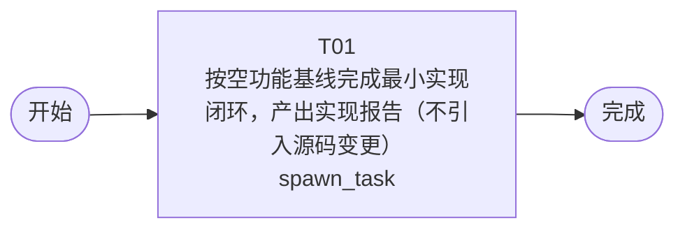

# 开发任务编排

<!-- sourcePlanId: plan:19e1a766-3c64-47f6-827d-71b4e59bde00 | rendererVersion: 4 -->

## 任务

| 任务 | 一句话目标 | 执行模式 | 依赖 | 能力 |
| --- | --- | --- | --- | --- |
| T01 | 按空功能基线完成最小实现闭环，产出实现报告（不引入源码变更） | spawn_task | - | engineering.implementation |

## 依赖执行图

## 任务契约

### T01

**目标**

## 目标

按已批准的空功能基线完成本工作项的最小实现闭环：

- 基线事实：需求基线 v0.1 为空功能基线（业务任务输入「1」为占位内容，无功能需求、验收条件与非功能约束，闭合结论为「输入不含可实现的产品需求」）；架构基线明确不冻结应用形态与技术栈，不生成 technical-contract.md，无可运行应用与启动契约。
- 实现范围：不引入任何产品源码、框架、依赖或构建配置变更；保持工作区现状（占位 README 与 docs 目录），不创建 app/src 等应用结构，不初始化任何技术栈。
- 产出：编写 docs/wi-t1000067/implementation-report.md，如实记录空基线实现结论（无源码产出、无功能性变更）、上游基线依据（requirements.md、architecture-baseline.md）与实际执行的核查结果。

## 验证

- 核查工作区未引入业务代码、依赖文件或应用目录结构。
- 核查实现报告内容与批准基线一致，不虚构功能实现或运行结果。

**角色:** general-app-development-expert  \  **失败策略:** block

**需求**

- （无）

**输入**

- docs/wi-t1000067/requirements.md
- docs/wi-t1000067/architecture-baseline.md

**产物**

- docs/wi-t1000067/implementation-report.md

**可写范围**

- docs/wi-t1000067/implementation-report.md

**完整写入路径**

- docs/wi-t1000067/implementation-report.md

**阻塞码**

- （无）
