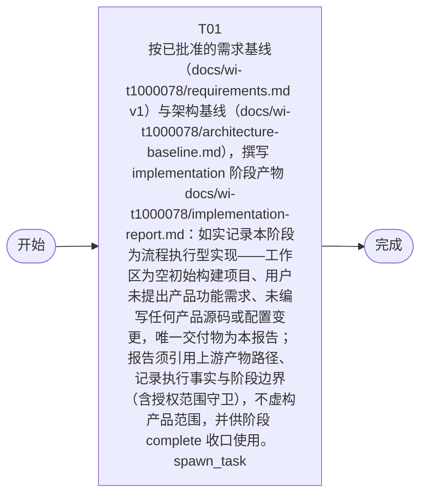

# 开发任务编排

<!-- sourcePlanId: plan:db9ea4c8-28f1-46d8-b8fc-1ff508e466f6 | rendererVersion: 3 -->

## 摘要

- Schema 版本: 1
- 需求来源: `sha256:836b95b7de52e3a5db9020586e18afa74bd76b30c480491859ebda02994822ce`
- 设计来源: `sha256:31535fc66a49403b4f8e9f2266292c164bec44bba66e971eb4e3a754c1d1172d`
- 任务数: 1

## 任务

| 任务 | 目标 | 执行模式 | 依赖 | 能力 |
| --- | --- | --- | --- | --- |
| T01 | 按已批准的需求基线（docs/wi-t1000078/requirements.md v1）与架构基线（docs/wi-t1000078/architecture-baseline.md），撰写 implementation 阶段产物 docs/wi-t1000078/implementation-report.md：如实记录本阶段为流程执行型实现——工作区为空初始构建项目、用户未提出产品功能需求、未编写任何产品源码或配置变更，唯一交付物为本报告；报告须引用上游产物路径、记录执行事实与阶段边界（含授权范围守卫），不虚构产品范围，并供阶段 complete 收口使用。 | spawn_task | - | engineering.implementation |

## 依赖执行图

### 文本备选

- T01 (根任务)

## 并行分组

- 层级 0: T01

## 任务契约

### T01

**目标:** 按已批准的需求基线（docs/wi-t1000078/requirements.md v1）与架构基线（docs/wi-t1000078/architecture-baseline.md），撰写 implementation 阶段产物 docs/wi-t1000078/implementation-report.md：如实记录本阶段为流程执行型实现——工作区为空初始构建项目、用户未提出产品功能需求、未编写任何产品源码或配置变更，唯一交付物为本报告；报告须引用上游产物路径、记录执行事实与阶段边界（含授权范围守卫），不虚构产品范围，并供阶段 complete 收口使用。

**角色:** general-app-development-expert  \  **失败策略:** block

**需求**

- G-01
- G-02
- G-03
- C-01
- C-02
- C-03

**输入**

- docs/wi-t1000078/requirements.md [sha256:836b95b7de52e3a5db9020586e18afa74bd76b30c480491859ebda02994822ce]
- docs/wi-t1000078/architecture-baseline.md [sha256:31535fc66a49403b4f8e9f2266292c164bec44bba66e971eb4e3a754c1d1172d]

**产物**

- docs/wi-t1000078/implementation-report.md

**可写范围**

- docs/wi-t1000078/implementation-report.md

**完整写入路径**

- docs/wi-t1000078/implementation-report.md

**验证命令**

- test -s docs/wi-t1000078/implementation-report.md

**阻塞码**

- （无）
